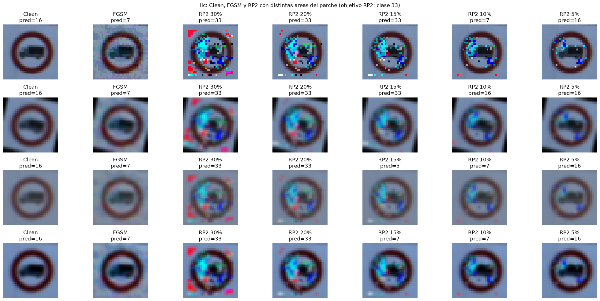
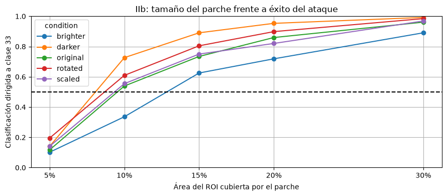
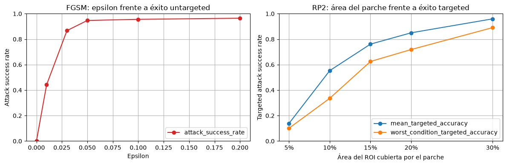

[English](README.md) | **Español**

# Parches adversarios físicos con RP2 sobre señales de tráfico

Implementación en PyTorch del algoritmo RP2 (*Robust Physical Perturbations*, Eykholt et al. 2018) contra una CNN entrenada con GTSRB, comparándolo con FGSM.



## Contenido

- `notebooks/P1_src1.ipynb`: FGSM sobre MNIST con una LeNet preentrenada. Es el notebook base de la asignatura, lo que hice fue analizarlo y verificar que el ataque está bien implementado (está explicado en la entrega p1b).
- `notebooks/P1_src2.ipynb`: el notebook principal. Entreno una CNN sobre GTSRB, implemento FGSM (untargeted y targeted) y RP2 en dos fases, y hago los experimentos de tamaño de parche y de robustez frente a transformaciones.
- `entrega/Entrega_p1a.pdf`: parte teórica (data poisoning vs adversarial attacks, ataques globales vs parches, RP2, etc.).
- `entrega/Entrega_p1b.pdf`: análisis del código y de los resultados.
- `notas/questions.txt`: dudas que me iba apuntando mientras leía los papers.

## FGSM vs RP2

FGSM es de un único paso y modifica todos los píxeles de la imagen al mismo tiempo, moviéndose en la dirección de `sign(gradiente)` con el paso máximo que permite el presupuesto epsilon. El resultado suele ser ruido de alta frecuencia, cambios pequeños que no sobreviven las transformaciones del mundo real (impresión, distancia, luz...). Y además, si la perturbación es sobre toda la escena, ¿cómo modificas lo que hay en el fondo, detrás de la señal? No es posible.

RP2 en cambio no perturba toda la imagen, sino que se centra en ciertas áreas (parches, mediante máscaras) y optimiza sobre muchas transformaciones a la vez (Expectation over Transformations), así que el parche tiene opciones de seguir funcionando cuando la señal se ve desde otro ángulo o con otra luz.

Lo implementé en dos fases, como en el paper:

1. **Fase 1**: se optimiza una perturbación con regularización L1 y una máscara que ocupa todo el área de la señal (el ROI que viene en el CSV de GTSRB). La L1 busca sparsity, así que la perturbación se concentra en las regiones más vulnerables, y de ahí se saca dónde colocar la máscara.
2. **Fase 2**: con la máscara ya fijada en esas regiones (me quedo con el 30%, 20%, 15%, 10% o 5% del ROI), se vuelve a optimizar el ruido dentro de ella con regularización L2 y total variation para que sea más suave.

En las dos fases el parche es uno solo, compartido por 128 imágenes de distintas clases, y en cada paso se les aplican transformaciones aleatorias (rotación de entre -15 y 15 grados, pequeñas traslaciones, escala entre 0.9 y 1.1 y cambios de contraste). El término NPS del paper (para que los colores se puedan imprimir) no lo he implementado, porque aquí todo se queda en digital.

El objetivo del ataque es la clase 33 de GTSRB.

## Resultados

Tamaño del parche frente al éxito del ataque dirigido, evaluado en cada condición (original, más brillo, más oscuro, rotada 15 grados y escalada):



Al reducir el tamaño del parche el ASR baja y las predicciones dejan de ser la que nosotros queremos. En algunos casos incluso acaba siendo la misma que da FGSM (clase 7). Con un 30% del ROI se pasa del 90% de éxito en todas las condiciones, y a partir del 15% se supera el 50% en todas. Por debajo de eso ya no es consistente. La condición que más le cuesta es la de más brillo.



Para untargeted, FGSM funciona muy bien (con epsilon = 0.05 ya pasa del 90%). Pero FGSM no se podría usar en un caso real porque modifica toda la imagen, mientras que RP2 sí, porque se limita a un área dentro del ROI.

La conclusión del paper es que no hay que confiar en el ruido físico (luz, distancia, ángulo) como protección, porque se puede optimizar sobre aproximaciones de esas transformaciones y obtener perturbaciones que siguen funcionando. Para defenderse lo más eficaz es el entrenamiento con ejemplos adversarios, que es justo lo que se ve en [defensive-distillation-cifar10](https://github.com/SilverDelgado/defensive-distillation-cifar10).

## Cómo ejecutarlo

```bash
pip install -r requirements.txt
```

- Dataset GTSRB: [German Traffic Sign Recognition Benchmark en Kaggle](https://www.kaggle.com/datasets/meowmeowmeowmeowmeow/gtsrb-german-traffic-sign) (la versión con `Train.csv`, `Test.csv` y `Meta/`). La variable `DATASET_ROOT` de `P1_src2.ipynb` apunta a la carpeta donde yo lo tenía, hay que cambiarla a la vuestra.
- `P1_src1.ipynb` necesita `lenet_mnist_model.pth`, que es el modelo LeNet del tutorial de FGSM de PyTorch, dentro de `data/`.

Los pesos y los datos no están en el repo.

## Referencias

- Goodfellow, Shlens, Szegedy. *Explaining and Harnessing Adversarial Examples*. 2015. [arXiv:1412.6572](https://arxiv.org/abs/1412.6572)
- Eykholt et al. *Robust Physical-World Attacks on Deep Learning Visual Classification*. CVPR 2018. [arXiv:1707.08945](https://arxiv.org/abs/1707.08945)
- Código original de los autores (TensorFlow): [evtimovi/robust_physical_perturbations](https://github.com/evtimovi/robust_physical_perturbations)
