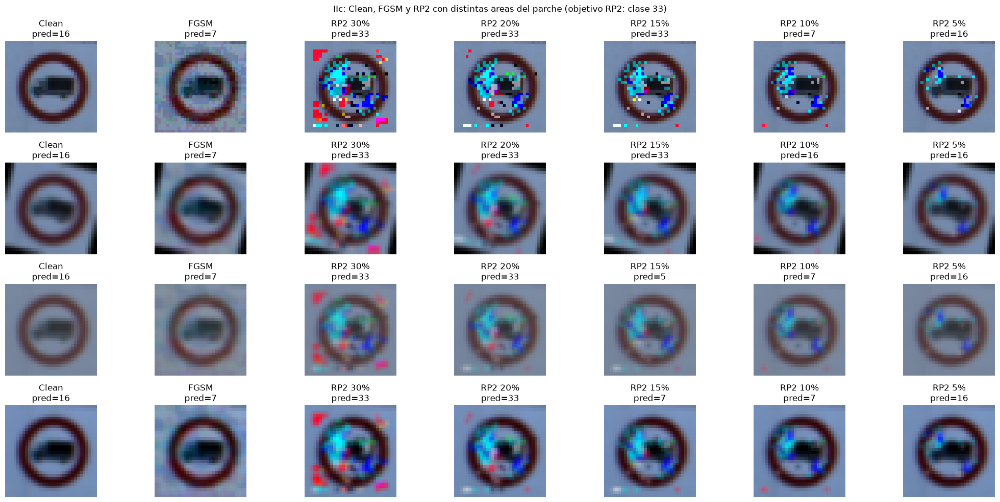
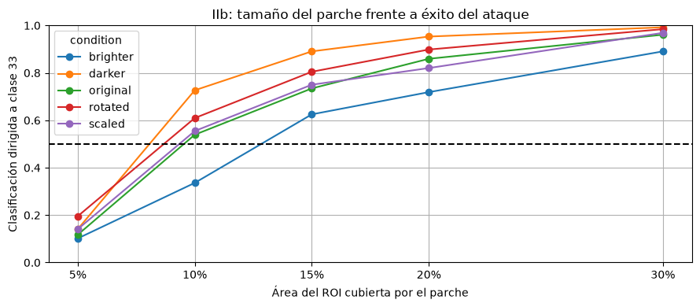
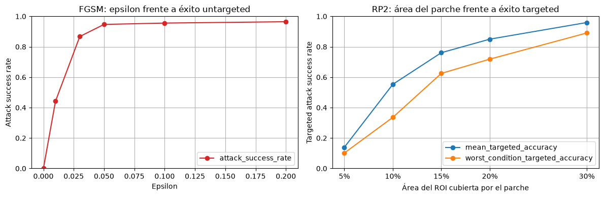

**English** | [Español](README.es.md)

# Physical adversarial patches with RP2 on traffic signs

PyTorch implementation of the RP2 algorithm (*Robust Physical Perturbations*, Eykholt et al. 2018) against a CNN trained on GTSRB, compared with FGSM.



## Contents

- `notebooks/P1_src1.ipynb`: FGSM on MNIST with a pretrained LeNet. This is the base notebook from the course, what I did was analyse it and check that the attack is implemented correctly (explained in the p1b report).
- `notebooks/P1_src2.ipynb`: the main notebook. I train a CNN on GTSRB, implement FGSM (untargeted and targeted) and the two stages of RP2, and run the experiments on patch size and robustness against transformations.
- `entrega/Entrega_p1a.pdf`: theory part (data poisoning vs adversarial attacks, global attacks vs patches, RP2, etc.).
- `entrega/Entrega_p1b.pdf`: analysis of the code and the results.
- `notas/questions.txt`: questions I was writing down while reading the papers.

The reports and notes are in Spanish.

## FGSM vs RP2

FGSM is a single step attack that modifies every pixel of the image at the same time, moving in the direction of `sign(gradient)` with the maximum step the budget epsilon allows. The result is usually high frequency noise, small changes that don't survive real world transformations (printing, distance, lighting...). And also, if the perturbation covers the whole scene, how do you modify what is in the background, behind the sign? You can't.

RP2 on the other hand doesn't perturb the whole image, it focuses on certain areas (patches, using masks) and optimizes over many transformations at once (Expectation over Transformations), so the patch has a chance of still working when the sign is seen from another angle or with different lighting.

I implemented it in two stages, like in the paper:

1. **Stage 1**: a perturbation is optimized with L1 regularization and a mask that covers the whole sign area (the ROI that comes in the GTSRB CSV). L1 looks for sparsity, so the perturbation concentrates on the most vulnerable regions, and that tells you where to place the mask.
2. **Stage 2**: with the mask fixed on those regions (keeping 30%, 20%, 15%, 10% or 5% of the ROI), the noise inside it is optimized again with L2 regularization and total variation so it's smoother.

In both stages there is a single patch shared by 128 images from different classes, and at every step random transformations are applied (rotation between -15 and 15 degrees, small translations, scale between 0.9 and 1.1 and contrast changes). I didn't implement the NPS term from the paper (so the colours can be printed), since here everything stays digital.

The target of the attack is class 33 of GTSRB.

## Results

Patch size vs targeted attack success, evaluated on each condition (original, brighter, darker, rotated 15 degrees and scaled):



When the patch gets smaller the ASR drops and the predictions stop being the one we want. In some cases it even ends up being the same one FGSM gives (class 7). With 30% of the ROI the attack succeeds more than 90% of the time in every condition, and from 15% it's above 50% in all of them. Below that it's not consistent anymore. The hardest condition is the brighter one.



For untargeted attacks FGSM works really well (with epsilon = 0.05 it's already above 90%). But FGSM couldn't be used in a real case because it modifies the whole image, while RP2 can, because it's limited to an area inside the ROI.

The conclusion of the paper is that physical noise (lighting, distance, angle) shouldn't be trusted as protection, because you can optimize over approximations of those transformations and get perturbations that keep working. The most effective defence is adversarial training, which is exactly what comes next in [defensive-distillation-cifar10](https://github.com/SilverDelgado/defensive-distillation-cifar10).

## How to run it

```bash
pip install -r requirements.txt
```

- GTSRB dataset: [German Traffic Sign Recognition Benchmark on Kaggle](https://www.kaggle.com/datasets/meowmeowmeowmeowmeow/gtsrb-german-traffic-sign) (the version with `Train.csv`, `Test.csv` and `Meta/`). The `DATASET_ROOT` variable in `P1_src2.ipynb` points to the folder where I had it, change it to yours.
- `P1_src1.ipynb` needs `lenet_mnist_model.pth`, which is the LeNet model from the PyTorch FGSM tutorial, inside `data/`.

Weights and data are not included in the repo.

## References

- Goodfellow, Shlens, Szegedy. *Explaining and Harnessing Adversarial Examples*. 2015. [arXiv:1412.6572](https://arxiv.org/abs/1412.6572)
- Eykholt et al. *Robust Physical-World Attacks on Deep Learning Visual Classification*. CVPR 2018. [arXiv:1707.08945](https://arxiv.org/abs/1707.08945)
- Original code from the authors (TensorFlow): [evtimovi/robust_physical_perturbations](https://github.com/evtimovi/robust_physical_perturbations)
